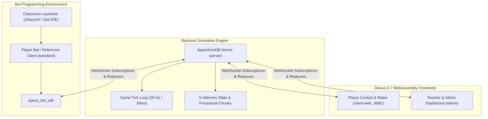

# Programmierspiel

> A multiplayer space programming game designed to teach Rust. Players command an orbital base, automate autonomous mining drones, and solve algorithmic research puzzles in a persistent universe powered by SpacetimeDB.

---

## Architecture Overview

The repository is organized as a Cargo workspace with five distinct crates:



### Workspace Crates

| Crate | Target | Role & Responsibilities |
|---|---|---|
| [`server`](file:///home/dietrich/Projekte/Source/programmierspiel/server) | `wasm32-unknown-unknown` (`cdylib`) | SpacetimeDB backend module: relational tables, transactional reducers, caller-filtered views, procedural asteroid field chunks, and research riddle generators. |
| [`client-web`](file:///home/dietrich/Projekte/Source/programmierspiel/client-web) | `wasm32-unknown-unknown` (Dioxus Web) | Interactive player cockpit: 2D HTML5 canvas radar, directional flight control, beginner quest drawer, audio feedback, and personal API token export. |
| [`admin`](file:///home/dietrich/Projekte/Source/programmierspiel/admin) | `wasm32-unknown-unknown` (Dioxus Web) | Teacher/operator console: god-view radar, live player/base inspection, game-loop controls, and manual asteroid replenishment. |
| [`space_bot_sdk`](file:///home/dietrich/Projekte/Source/programmierspiel/space_bot_sdk) | Native Rust | High-level client SDK for bot development: exposes the [`BaseController`](file:///home/dietrich/Projekte/Source/programmierspiel/space_bot_sdk/src/world.rs#L59-L65) trait, sensory [`World`](file:///home/dietrich/Projekte/Source/programmierspiel/space_bot_sdk/src/world.rs#L8-L56) snapshot, [`Actions`](file:///home/dietrich/Projekte/Source/programmierspiel/space_bot_sdk/src/action.rs#L50-L106) buffer, and algorithmic research solvers. |
| [`testclient`](file:///home/dietrich/Projekte/Source/programmierspiel/testclient) | Native Rust binary | Starter bot implementation showing autonomous mining, docking cycles, drone construction, and research requests. |

---

## Quickstart

Follow these steps in sequence to boot the full local stack.

### 1. Prerequisites

- **Rust**: Nightly or Stable (2024 edition compatible).
- **Dioxus CLI**: `dx` (version 0.7.x) for web client builds.
  ```bash
  cargo install dioxus-cli --version 0.7.10 --locked
  ```
- **SpacetimeDB CLI**: Use the custom local binary located at `../SpacetimeDB/target/release/spacetimedb-cli`.

### 2. Start SpacetimeDB & Publish Server Module

Run SpacetimeDB locally and publish the [`server`](file:///home/dietrich/Projekte/Source/programmierspiel/server) database module:

```bash
# Start the SpacetimeDB standalone node (in a background terminal)
../SpacetimeDB/target/release/spacetimedb-cli start

# Publish the server module to the local node
../SpacetimeDB/target/release/spacetimedb-cli publish -p server server
```

**Completion criterion:** The command outputs `Published module server` and logs initialization of procedural chunks with the 50ms game tick schedule.

### 3. Launch the Web Cockpit

Serve the player web frontend with live reloading:

```bash
dx serve -p client-web
```

**Completion criterion:** Open [http://localhost:8081](http://localhost:8081) in a web browser. The cockpit renders the Mega-Station radar, player sign-in form, and quest drawer.

### 4. Deploy Base & Connect a Bot

1. Open [http://localhost:8081](http://localhost:8081), register a player callsign and colors.
2. Fly the Tier 0 Builder Ship outside the exclusion zone (> 250m from Mega-Station) and click **Deploy Base**.
3. Open the cockpit drawer, copy your **Personal API Identity Token**.
4. Paste the token into [`testclient/config.toml`](file:///home/dietrich/Projekte/Source/programmierspiel/testclient/config.toml):
   ```toml
   server_url = "http://127.0.0.1:3000"
   module_name = "server"
   auth_token = "<PASTE_YOUR_COPIED_TOKEN_HERE>"
   ```
5. Run the bot:
   ```bash
   cargo run -p testclient
   ```

**Completion criterion:** Terminal prints `Verbindung erfolgreich!` and the bot starts issuing tick commands. In the web radar, your drones navigate to asteroids, mine ore, and dock at your base station.

### 5. Launch the Admin Console (Optional)

```bash
dx serve -p admin
```

> [!IMPORTANT]
> The admin app targets WebAssembly. Always use `dx build -p admin` or `dx serve -p admin` to build or check the admin project. Running standard native `cargo build -p admin` fails due to browser-specific dependencies. See [`.agents/rules/build_admin.md`](file:///home/dietrich/Projekte/Source/programmierspiel/.agents/rules/build_admin.md).

---

## Programming with `space_bot_sdk`

Autonomous bots implement the [`BaseController`](file:///home/dietrich/Projekte/Source/programmierspiel/space_bot_sdk/src/world.rs#L59-L65) trait. The runtime invokes `tick` 10 times per second (every 100ms), passing a sensory view of the world and a command buffer.

```rust
use space_bot_sdk::{Actions, BaseController, RiddleSolution, UpgradeTrack, World};

struct MiningBot;

impl BaseController for MiningBot {
    fn tick(&mut self, world: &World, actions: &mut Actions) {
        // 1. Autonomous Drone Fleet Control
        for drone in world.fleet {
            if drone.cargo_is_full() {
                // Return to base to unload ore and recharge batteries
                actions.dock(drone.ship_id);
            } else if let Some(asteroid) = world.closest_asteroid_with_ore(drone.position) {
                // Fly to closest asteroid and extract resources
                actions.mine(drone.ship_id, asteroid.asteroid_id);
            }
        }

        // 2. Fleet Expansion
        if world.fleet.len() < 3 && world.base.stored_ore >= 50 {
            actions.build_drone(1); // Tier 1 Drone costs 50 ore
        }

        // 3. Algorithmic Research Upgrades
        match world.active_riddle {
            None => {
                actions.request_research(UpgradeTrack::DroneScanner);
            }
            Some(space_bot_sdk::RiddleTask::Sort { numbers }) => {
                let mut sorted = numbers.clone();
                sorted.sort();
                actions.solve_riddle(RiddleSolution::Sort(sorted));
            }
            _ => {}
        }
    }
}

fn main() {
    space_bot_sdk::run(MiningBot);
}
```

### Bot Pairing & Zero-Friction Token Flow

Bots connect using a decentralized device-pairing workflow:
1. When starting a bot crate without an existing `auth_token` in `config.toml`, `space_bot_sdk` connects anonymously.
2. SpacetimeDB returns a newly minted connection token and identity in `on_connect`.
3. The SDK saves `auth_token = "<token>"` automatically back into `config.toml`.
4. The bot outputs its 64-character hex **Identity** to the console and waits reactively.
5. In the Web Cockpit (`client-web`), the player pastes the identity into the **Heimatbasis Modal** (for Home Base + Fleet control) or the **Ship Radar Inspector** (for Warship / Explorer / Miner Ship bots).
6. Once registered via `register_ai_agent`, SpacetimeDB reactively sends scoped sensor views, and the bot immediately starts running!

### Single Ship / Warship Bots ([`ShipController`](file:///home/dietrich/Projekte/Source/programmierspiel/space_bot_sdk/src/world.rs#L44-L50))

To control individual warships, mining stations, or scout ships independently:

```rust
use space_bot_sdk::{Actions, ShipController, ShipWorld};

struct WarshipBot;

impl ShipController for WarshipBot {
    fn tick(&mut self, world: &ShipWorld, actions: &mut Actions) {
        let ship = world.ship;
        // Commands are scoped to this ship and its sensor bubble
        if let Some(target) = world.asteroids.first() {
            actions.mine(ship.ship_id, target.asteroid_id);
        }
    }
}

fn main() {
    space_bot_sdk::run_ship(WarshipBot);
}
```

### Sensory API ([`World`](file:///home/dietrich/Projekte/Source/programmierspiel/space_bot_sdk/src/world.rs#L8-L56))

- `world.base`: Current player station status ([`BaseStation`](file:///home/dietrich/Projekte/Source/programmierspiel/server/src/models.rs#L50-L70)) — stored ore, energy, position, upgrade tiers.
- `world.fleet`: Slice of own [`Ship`](file:///home/dietrich/Projekte/Source/programmierspiel/space_bot_sdk/src/radar.rs#L34-L58) entities (`drone.cargo_is_full()`, `drone.energy_percent()`, `drone.position`).
- `world.asteroids`: All perceived asteroids ([`PerceivedAsteroid`](file:///home/dietrich/Projekte/Source/programmierspiel/server/src/models.rs#L217-L231)) within radar horizon.
- `world.closest_asteroid_with_ore(from)`: Helper finding nearest asteroid with `remaining_ore > 0`.
- `world.other_drones` & `world.other_bases`: Visible foreign entities detected by scanner arrays.
- `world.active_riddle`: Optional [`RiddleTask`](file:///home/dietrich/Projekte/Source/programmierspiel/space_bot_sdk/src/research.rs#L81-L120) when research is active.

### Command Buffer ([`Actions`](file:///home/dietrich/Projekte/Source/programmierspiel/space_bot_sdk/src/action.rs#L50-L106))

- `actions.mine(ship_id, asteroid_id)`: Orders a drone to fly to an asteroid and mine ore.
- `actions.dock(ship_id)`: Orders a drone to dock at the home base, unload cargo, and recharge energy.
- `actions.fly_to(ship_id, target_vec)`: Moves a ship to explicit 2D coordinates.
- `actions.stop(ship_id)`: Immediately arrests ship velocity.
- `actions.build_drone(tier)`: Queues drone construction at base (Tier 1: 50 ore; Tier 2: 150 ore).
- `actions.request_research(track)`: Requests a research riddle for a base subsystem.
- `actions.solve_riddle(solution)`: Submits algorithmic solution to advance research progress.

### Research Upgrade Tracks

| Track | Subsystem | Upgrade Effect | Algorithmic Problem |
|---|---|---|---|
| **1: `DroneScanner`** | Drone Sensor Pod | Increases drone vision radius (150m to 350m) | **List Sorting**: Sort integer telemetries in ascending order. |
| **2: `BaseAsteroidScanner`** | Base Radar Array | Increases asteroid/base scan radius (300m to 700m) | **Euclidean Geometry**: Calculate 2D Pythagorean distances from base to target vectors. |
| **3: `RadarHorizon`** | Deep Space Receiver | Extends horizon for unidentified contacts (600m to 1200m) | **Signal Denoising**: Filter isolated noise spikes exceeding a dynamic threshold. |

---

## Critical Development Rules & Invariants

Developers and AI agents working on this codebase must observe the following constraints:

### 1. Generating SpacetimeDB Bindings

Autogenerated files in `module_bindings/` must **never** be manually edited. Regenerate bindings using the custom local `spacetimedb-cli` sibling binary followed immediately by `cargo fmt`:

```bash
# Generate bindings for Dioxus Admin & Web frontends
../SpacetimeDB/target/release/spacetimedb-cli generate --lang=dioxus -p server -o admin/src/module_bindings/ && cargo fmt -p admin

# Generate bindings for Rust Bot SDK
../SpacetimeDB/target/release/spacetimedb-cli generate --lang=rust -p server -o space_bot_sdk/src/module_bindings/ && cargo fmt -p space_bot_sdk
```

See [`.agents/rules/generate_bindings.md`](file:///home/dietrich/Projekte/Source/programmierspiel/.agents/rules/generate_bindings.md).

### 2. SpacetimeDB Views & Aggregation Guidelines

- **No Reducer-Cached Counts**: Do not cache aggregate totals in persistent table columns during mutation reducers. This prevents write amplification and state desynchronization.
- **No Full-Table `.iter()` in Views**: SpacetimeDB 2.x `ViewHandle` does not support table iteration.
- **Constant-Time Counts**: Use `#[spacetimedb::view(accessor = <name>, public)]` taking `ctx: &AnonymousViewContext` and calling `ctx.db.<table>().count()`. This is an $O(1)$ table metadata lookup cached across subscriptions.
- **Indexed Iteration**: For filtered subsets, query indexed columns (`ctx.db.<table>().<column>().filter(&val)`), which return iterators supporting `.count()` and `.map()`.

See [`.agents/rules/spacetimedb_views.md`](file:///home/dietrich/Projekte/Source/programmierspiel/.agents/rules/spacetimedb_views.md).

### 3. Terminology & Naming

Always write out **"Kommunikationszentrum"** in full, or use neutral terminology like *"Kommunikation"*, *"the platform"*, or *"the server"*. Never abbreviate as *"KZ"*. See [`.agents/rules/naming_conventions.md`](file:///home/dietrich/Projekte/Source/programmierspiel/.agents/rules/naming_conventions.md).

---

## Classroom Integration (`uhlaunch` & Zed)

For schools and training workshops, students access their coding environment via [`uhlaunch`](file:///home/dietrich/Projekte/Source/uhlaunch):
1. Launch `uhlaunch` from the desktop environment.
2. Select **Programmierspiel** to clone/fork the student repository and open it automatically in the Zed editor.
3. Configure `config.toml` with the API token from the web cockpit.
4. Execute `cargo run` in the integrated Zed terminal to connect the player fleet.

---

## Progressive Disclosure & Reference Links

- SpacetimeDB Architecture Reference: [`.agents/skills/spacetimedb/SKILL.md`](file:///home/dietrich/Projekte/Source/programmierspiel/.agents/skills/spacetimedb/SKILL.md)
- Reducer & Schema Models: [`server/src/models.rs`](file:///home/dietrich/Projekte/Source/programmierspiel/server/src/models.rs)
- Research Riddle Generator: [`server/src/riddles.rs`](file:///home/dietrich/Projekte/Source/programmierspiel/server/src/riddles.rs)
- Radar Math & Physics: [`server/src/math.rs`](file:///home/dietrich/Projekte/Source/programmierspiel/server/src/math.rs)
- Web Tutorial Missions: [`client-web/src/tutorial.rs`](file:///home/dietrich/Projekte/Source/programmierspiel/client-web/src/tutorial.rs)
